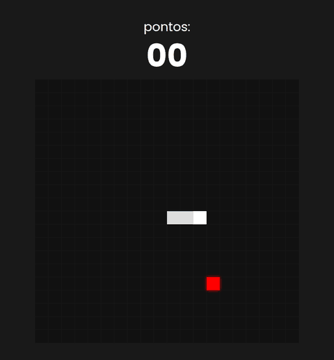
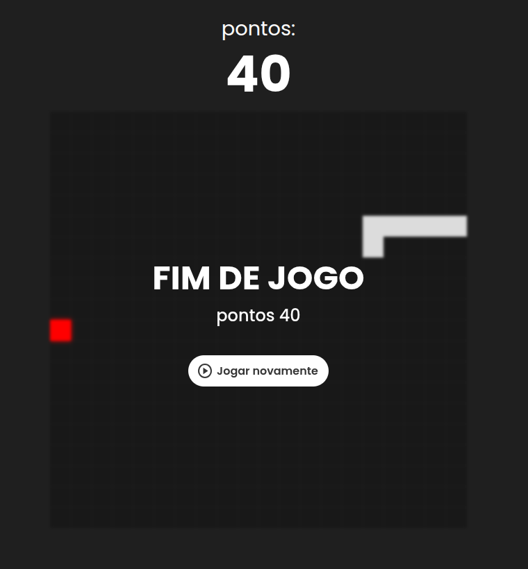

# 🐍 Snake Game

Versão do clássico jogo da cobrinha feita com **HTML, CSS e JavaScript puro**, desenhada em um `<canvas>`. Sem frameworks, sem dependências e sem etapa de build.

**▶️ [Jogar agora](https://pedrovizkyh.github.io/Snake-Game-JS/)**



## Como jogar

Controle a cobra para comer a comida vermelha. A cada comida a cobra cresce e você ganha 10 pontos. O jogo termina se a cobra bater na parede ou nela mesma.

| Ação | Teclas |
| --- | --- |
| Subir | `↑` ou `W` |
| Descer | `↓` ou `S` |
| Esquerda | `←` ou `A` |
| Direita | `→` ou `D` |

A cobra só começa a andar depois da primeira tecla pressionada. Depois do fim de jogo, clique em **Jogar novamente** para recomeçar.

## Como rodar

Não precisa instalar nada:

1. Clone ou baixe o repositório:
   ```bash
   git clone https://github.com/Pedrovizkyh/Snake-Game-JS.git
   ```
2. Abra o `index.html` no navegador.

Se o som não tocar ao abrir o arquivo direto (`file://`), alguns navegadores bloqueiam o áudio nesse modo. Nesse caso, sirva a pasta com um servidor local, por exemplo:

```bash
# Python
python3 -m http.server 8000

# ou Node.js
npx serve
```

E acesse `http://localhost:8000`.

## Capturas de tela

<p align="center">
  
</p>

## Estrutura do projeto

```
.
├── index.html
├── css/
│   └── style.css
├── js/
│   └── script.js
└── assets/
    ├── audio.mp3
    ├── preview.gif
    └── game-over.png
```

## Detalhes técnicos

- **Grade de 20×20** células de 30px, em um canvas de 600×600.
- **Loop do jogo** com `setTimeout` a cada 150ms, configurável pela constante `SPEED` no `script.js`.
- **Direções como vetores** `{x, y}`, o que simplifica o movimento e a checagem de direção oposta.
- **Anti-reversão:** a direção pedida é comparada com a última direção em que a cobra realmente andou, então apertar duas teclas rápido não faz a cobra voltar sobre si mesma.
- **Comida** sempre nasce em uma célula livre, fora do corpo da cobra.
- **Canvas responsivo:** o desenho usa coordenadas internas fixas e é escalado via CSS em telas menores.

## Personalização

As principais constantes ficam no topo do `js/script.js`:

| Constante | O que controla |
| --- | --- |
| `SIZE` | Tamanho de cada célula, em pixels |
| `SPEED` | Intervalo entre movimentos, em ms (menor = mais rápido) |
| `POINTS_PER_FOOD` | Pontos ganhos por comida |

As cores da cobra, da comida e da grade estão nas funções `drawSnake`, `drawFood` e `drawGrid`.

## Ideias para evoluir

- Controle por toque (swipe ou botões direcionais) para jogar no celular
- Recorde salvo no `localStorage`
- Aumento gradual da velocidade conforme a pontuação
- Botão de pausa
- Modo sem paredes, em que a cobra atravessa a borda

## Tecnologias

- HTML5 e Canvas API
- CSS3
- JavaScript (ES6+)
- Fonte [Poppins](https://fonts.google.com/specimen/Poppins) e ícones [Material Symbols](https://fonts.google.com/icons), ambos do Google Fonts
